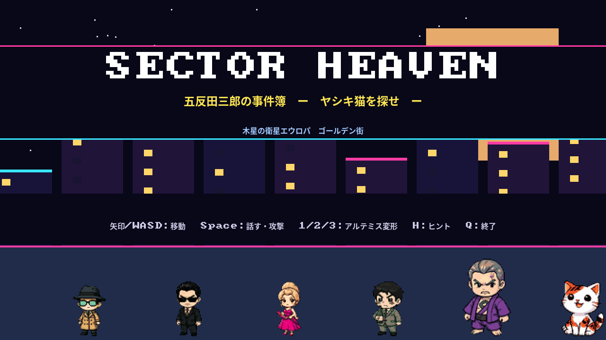
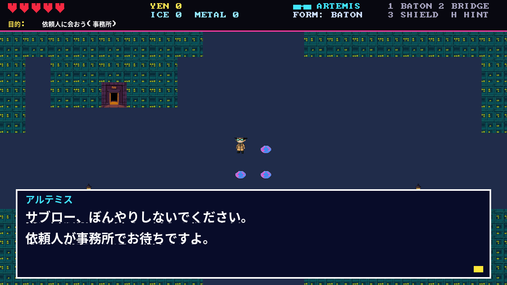
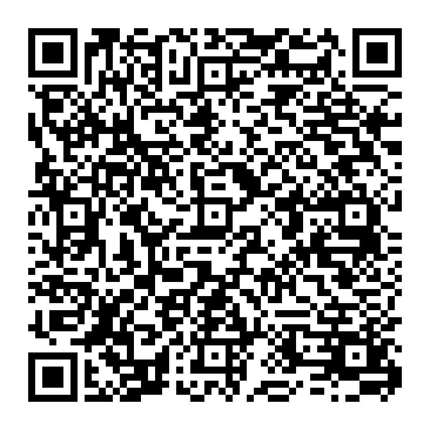
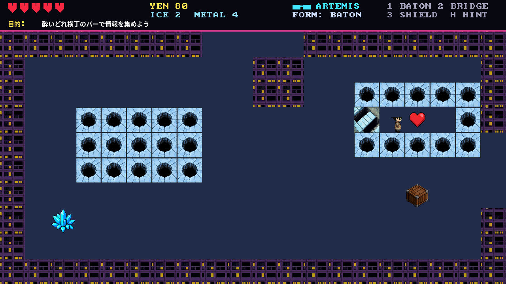
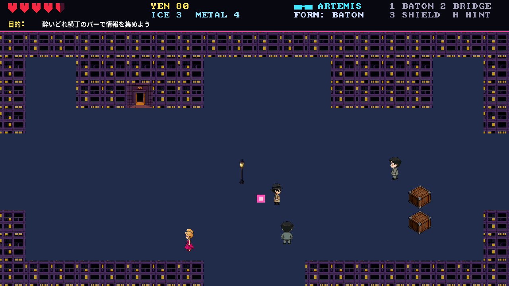
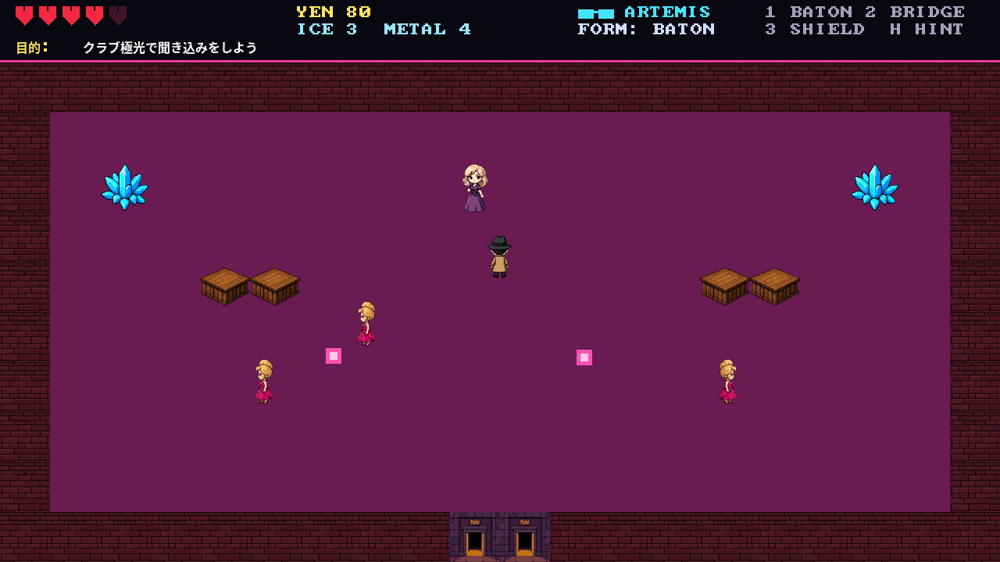
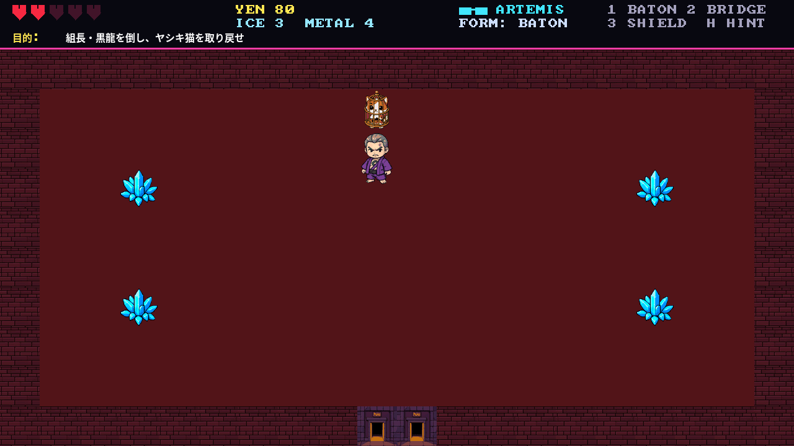
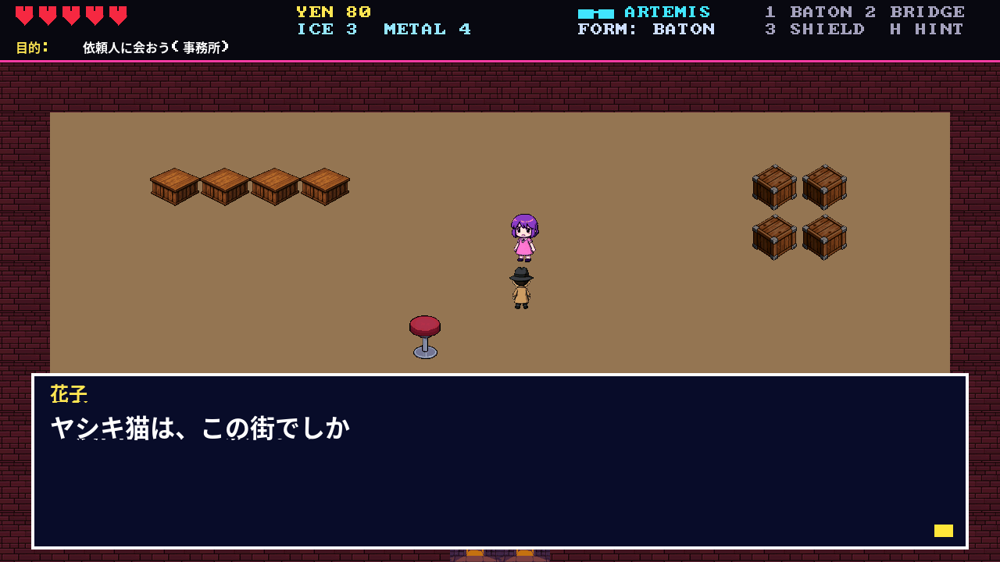

# SECTOR HEAVEN — 五反田三郎の事件簿

[MeOS](https://github.com/shi3z/MeOS-app-sdk)（M5Stack Tab5）用の、見下ろし型アクションアドベンチャーです。
A top-down detective adventure for MeOS on the M5Stack Tab5, built with the [MeOS App SDK](https://github.com/shi3z/MeOS-app-sdk).



## ストーリー

木星の衛星エウロパ。氷の下に海を抱くこの星のゴールデン街、通称 **セクターヘブン**。
私立探偵 **五反田三郎** は、行方不明の **ヤシキ猫**（錦鯉のような赤・黒・白のぶち模様をもつ、この街だけの猫）を探して夜のネオン街を歩く。

行く手を阻むのはヤクザ、酔っ払い、そしてホステスたち。
聞き込みを重ねるうちに、猫の模様に隠された「天国の鍵」と、この街に隠された世界の謎が見えてくる——。

相棒は、サングラス型の量子知能 **アルテミス**。素材さえあれば、どんな形にも姿を変えられる。



## インストール (QR コード)



1. Tab5 で `install` と入力
2. 上の QR コードをカメラにかざす（`dist/gotanda_qr.png` を表示するか印刷）
3. 名前・権限が表示されるので Enter
4. `gotanda` と入力して起動

QR には `.wasm` の SHA-256 が入っているので、Tab5 はこのファイルと一致するものだけをインストールします。
リンクで入れる場合: `install https://raw.githubusercontent.com/shi3z/MeOS-Gotanda/main/dist/gotanda.wasm`

必要な権限は `C`（コンソール）と `D`（画面）だけ。サイズは約 105 KB、メモリは 512 KB（アートのデータ 約 80 KB と、デコードしたスプライト用バッファ 約 300 KB）です。

## 操作

| キー | 動作 |
|---|---|
| 矢印 / WASD | 歩く |
| Space (または Enter / E / J) | 目の前の人に話す。誰もいなければ警棒で攻撃 |
| 1 | 警棒（通常の姿） |
| 2 | **氷の橋** — 目の前の亀裂に橋をかける（氷 ×1） |
| 3 | **金属の盾** — 6 秒間、飛び道具を防ぎ、被ダメージを半減（金属 ×2） |
| H | アルテミスのヒント（次の目的を教えてくれる） |
| Enter / Space | 会話を進める |
| Q | 終了 |

### アルテミスの変形

アルテミスは「素材」があれば姿を変えます。

- **氷**: 氷の結晶を警棒で斬ると手に入る
- **金属**: ヤクザを倒すと落とす
- 亀裂に囲まれた場所にあるハートの器は、氷の橋でなければ届きません。
- ホステスのハイヒール（飛び道具）には、金属の盾が有効です。



## 世界と登場人物

セクターヘブンは 12 のエリアと 5 つの屋内からなります。画面端から隣のエリアへ、ドアから建物の中へ。

- **ヤクザ**: 追いかけてくる。倒すと金属や小銭を落とす
- **酔っ払い**: ふらふら歩く。小銭と体力回復を落とす
- **ホステス**: 距離を取ってハイヒールを投げてくる
- **組長・黒龍**: 突進してくる。壁にぶつかって動けなくなった隙が攻撃のチャンス







屋台のおでん（50 円）で体力が全回復します。体力は赤いハート（半分単位）、ゲームオーバーでも進行状況は保たれ、広場からやり直せます。

ネタバレを避けるため詳細は書きませんが、依頼人に会うところから始まり、バー → クラブ → 黒龍会 の順に手がかりをたどります。迷ったら **H** を押してください。



## グラフィックス

キャラクター、背景、アイテムの絵はすべて **FLUX.2 [klein] 4B** で生成した画像を、16 色のドット絵に落とし込んだものです。

- 主人公・敵・ボスは、正面を生成したあと、**参照画像つきの編集**で背面と横向きを作り、同じキャラクターとしてそろえています（左向きは右向きの反転）。
- 壁は窓のグリッドの絵から、周期を検出して継ぎ目なく並ぶ 64×64 に切り出しています。
- 生成 → 背景除去（外周からの塗りつぶし）→ 縮小 → 16 色化 → 4bpp で `gotanda_art.h` に埋め込み、の流れは `assets/` にあります。

```sh
# FLUX.2 klein のサーバー (titan の RTX 3090) へトンネルを張って生成
ssh -f -N -L 8501:127.0.0.1:8501 shi3z@titan
python3 assets/gen_chars.py          # キャラクター (正面 + 背面/横向き)
python3 assets/gen_tiles.py          # タイル・オブジェクト・アイコン
python3 assets/build_assets.py --preview assets/raw   # -> gotanda_art.h と確認用の一覧画像
```

生成した元画像 (`assets/raw/`, 約 80 MB) はリポジトリに含めていません。`gotanda_art.h` だけでビルドできます。

## ビルド

```sh
git clone https://github.com/shi3z/MeOS-app-sdk
git clone https://github.com/shi3z/MeOS-Gotanda && cd MeOS-Gotanda

# pip 版 Zig を使う build.sh (clang 不要)
pip install ziglang && SDK=../MeOS-app-sdk ./build.sh

# SDK の tools/meos-build を使う場合: アートのデータが 64 KB を超えるため、
# スクリプト内の -Wl,--initial-memory=65536 を 131072 に変えてください

# QR コードの再生成 (wasm を作り直すとハッシュが変わります)
pip install qrcode pillow
../MeOS-app-sdk/tools/mkqr.py https://raw.githubusercontent.com/shi3z/MeOS-Gotanda/main/dist/gotanda.wasm dist/gotanda.wasm -o gotanda_qr.png
```

### 日本語入りスクリーンショット

SDK のシミュレータは日本語を `?` で描画します。`devtools/jpshot.py` は、シミュレータが受け取った日本語テキストを記録し、
システムの CJK フォントで画像に重ねます（このリポジトリのスクリーンショットはこれで撮りました）。

```sh
SDK=../MeOS-app-sdk python devtools/jpshot.py gotanda.c --frames 60 --shot 59 --keys "20:enter,40:enter" --out shots
# --define DEBUG_ROOM=14 --define DEBUG_PROG=2 で任意の部屋・進行度から開始
```

*スクリーンショットはシミュレータの出力です。実機の描画（フォント・速度）とは異なる場合があります。*

## 実装メモ

- `gotanda.c` 1 ファイル + `gotanda_art.h`（生成物）。HUD 80 px + 20×10 タイル（64 px）の画面切り替え式。マップは起動時に小さな命令表から組み立てます。
- アートは 16 色パレット + 4bpp で埋め込み、初めて使うときに RGB565 バッファへデコードします（`memory.grow` で確保した領域）。`blit` には透過が無いため、透過色は部屋の床色にデコードします。
  キャラクターの絵は当たり判定より上に頭がはみ出すので、その上のマスに壁・物・NPC があるときは、はみ出し部分を切り取って描きます。
- **描画は差分だけ**: 部屋の背景（床・建物・NPC・アイテム）は入室時に一度だけ描きます。毎フレームは、動くものの下のマスだけを描き直し、キャラクターを重ねます。
  1 フレームの描画呼び出しは約 20 回、ピクセル量は約 7 万（以前は約 440 回・130 万）です。
- **キャラクターは 1 回の `blit`**: 床は部屋ごとのべた塗りにして、スプライトをその色に合わせてデコードしておきます。
- ゲームの進行は実時間の 30 ステップ/秒に固定されているので、描画が遅れても速度は落ちず、コマ落ちするだけです。
- 30 fps 目標、ダブルバッファ。画面外にはみ出す `fill` は拒否されるため `rect()` でクリップしています。
- 会話は 1 行 34 文字以内・3 行まで。日本語は 1 文字 = 1 セル（`scale` 4 で 32 px）で描画します。
- libc が無いので `memset`/`memcpy` を自前で用意しています（wasm ビルド時のみ）。
- Node でスタブ化した画面関数を使い、ランダム入力 3 万フレーム × 7 通りで、トラップと画面外描画が無いことを確認済み。
- **未確認**: 実機（wasm3）での速度と、Tab5 の 16×16 フォントが全ての漢字（「龍」「鯉」など）を持っているか。

## English

Install: type `install` on the Tab5, show `gotanda_qr.png` to the camera, then type `gotanda`.
Controls: arrows / WASD walk, Space talk / swing the baton, 1/2/3 Artemis forms (baton / ice bridge / metal shield), H hint, Q quit.
Private eye Saburo Gotanda searches Europa's golden-gai "Sector Heaven" for a missing koi-patterned Yashiki cat, guided by Artemis,
a quantum intelligence that takes the shape of his sunglasses and can become anything given the raw material.

## License

画像は FLUX.2 [klein] 4B で生成しています（モデルのライセンスを公開前に確認してください）。（未設定）"The Legend of Zelda" is a trademark of Nintendo; this is an original game that borrows the top-down room-by-room adventure style. All code and graphics are original.
